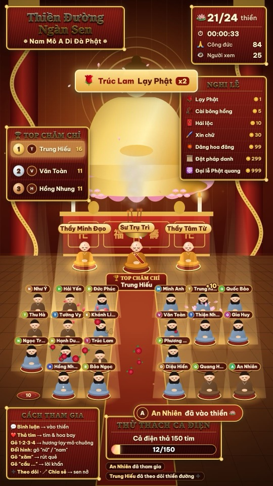
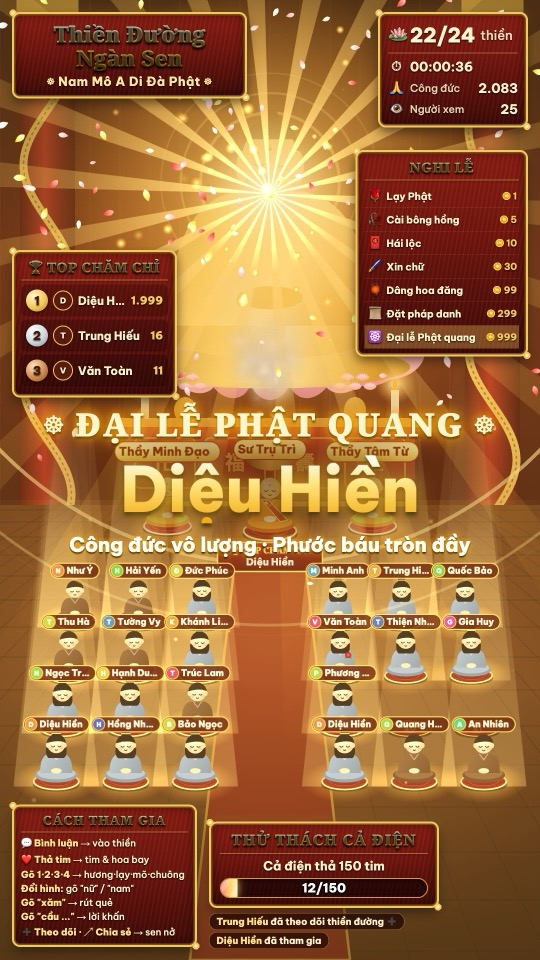
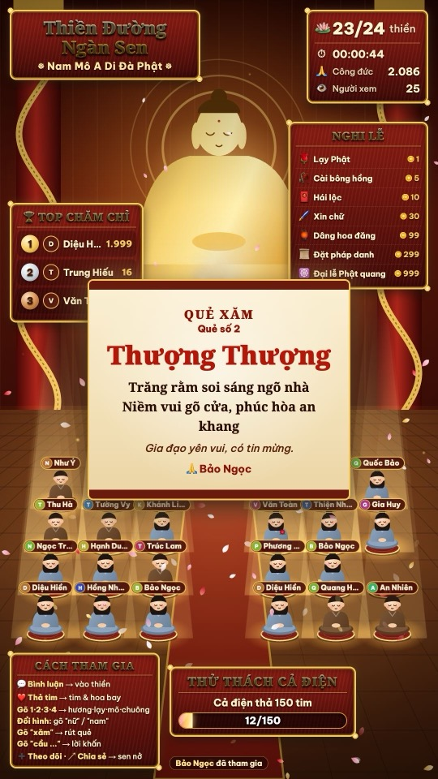
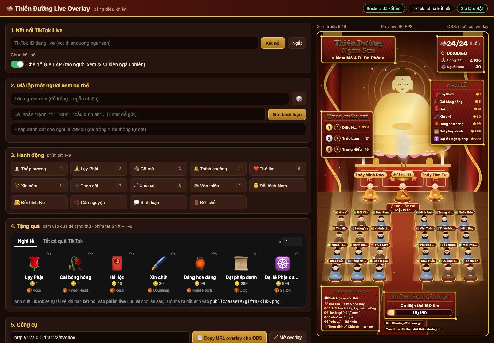
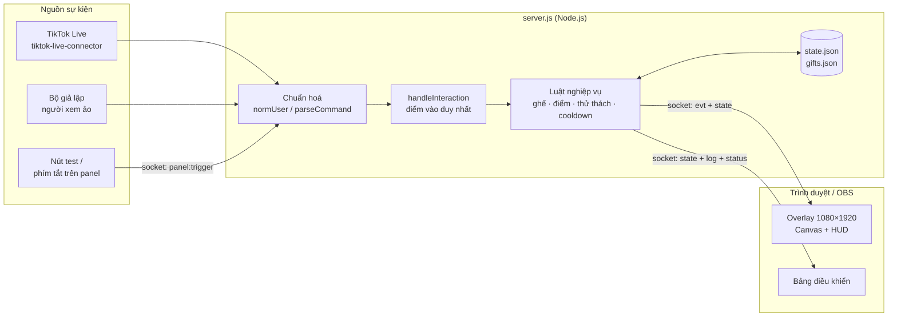
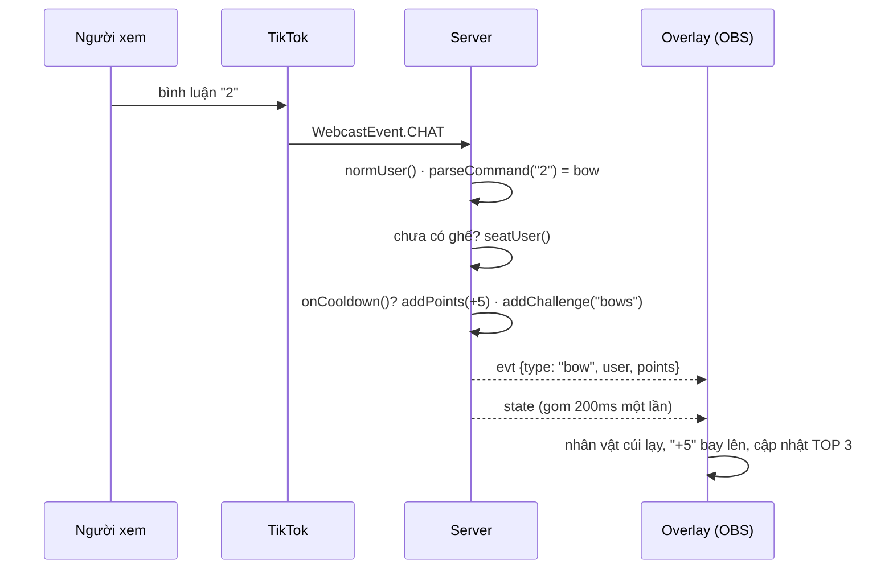

# 🪷 Thiền Đường Live Overlay

**Overlay tương tác thời gian thực cho TikTok Live.** Người xem bình luận, thả tim, tặng quà thì nhân vật của họ xuất hiện trong chánh điện và thực hiện hành động tương ứng (thắp hương, lạy Phật, gõ mõ, rút xăm...), ngay trên màn hình livestream.


| Overlay trong OBS (9:16) | Hiệu ứng quà lớn | Rút quẻ xăm |
|:---:|:---:|:---:|
|  |  |  |

**Bảng điều khiển** (kết nối TikTok, giả lập, khay quà kiểu TikTok, xem trước trực tiếp):



---

## Tóm tắt trong 30 giây

| | |
|---|---|
| **Bài toán** | Livestream TikTok cần một "sân khấu" phản hồi ngay với từng tương tác của khán giả, để người xem thấy chính mình trên màn hình và có lý do để ở lại, bình luận, tặng quà. |
| **Giải pháp** | Một server Node.js nghe sự kiện TikTok Live, chuẩn hoá thành sự kiện nội bộ, áp luật nghiệp vụ (ghế ngồi, điểm, thử thách, chống spam), rồi đẩy qua WebSocket tới trang overlay vẽ bằng Canvas, được OBS nhúng làm Browser Source. |
| **Quy mô code** | ~4.000 dòng JavaScript thuần, không framework frontend, không bước build. 3 dependency: `express`, `socket.io`, `tiktok-live-connector`. |
| **Điểm kỹ thuật** | Kiến trúc hướng sự kiện, server là nguồn sự thật duy nhất, hàng đợi hiệu ứng không chồng nhau, vẽ 60 FPS với sprite cache, lưu trạng thái an toàn (atomic write), tự kết nối lại có backoff, cấu hình hot-reload. |

---

## Kiến trúc tổng thể



**Quyết định thiết kế chính:** mọi nguồn (TikTok thật, giả lập, nút test) đi qua **cùng một hàm `handleInteraction`**. Nhờ vậy những gì test được bằng giả lập cũng chính là logic chạy khi live thật, không có nhánh code riêng cho test.

### Luồng một sự kiện, từ bình luận đến hình ảnh



Server gửi hai loại tin cho client:
- **`evt`**: sự kiện rời rạc để chạy hiệu ứng (lạy, chuông, quà...).
- **`state`**: ảnh chụp trạng thái (ghế, top, thử thách), **gom tối đa 200 ms một lần** để 100 lượt tim mỗi giây không thành 100 lần gửi.

Overlay chỉ hiển thị, không tự giữ luật. Mở lại OBS hay mở thêm overlay thì đều nhận ngay trạng thái đúng.

---

## Các phần logic chính

### 1. Phân tích lệnh chat ([server.js](server.js), `parseCommand`)
Bình luận được chuẩn hoá Unicode (NFC), viết thường, bỏ dấu câu cuối rồi khớp theo thứ tự:

| Bình luận | Lệnh | Ghi chú |
|---|---|---|
| `1` `2` `3` `4` | hương / lạy / mõ / chuông | cooldown 1,2 s mỗi người |
| `nam`, `nữ` (cả `nu`) | đổi hình nhân vật | |
| `xăm`, `xin xăm`, `rút quẻ`... | rút quẻ | regex chấp nhận gõ không dấu |
| `cầu <lời>` | bong bóng lời khấn | cắt 80 ký tự |
| còn lại | bong bóng chat | điểm chat tối đa 1 lần / 3 s |

### 2. Xếp chỗ ngồi và hàng chờ (`seatOrder`, `seatUser`, kiểm tra treo máy)
- 24 bồ đoàn chia hai dãy. Thứ tự ưu tiên: **hàng trên trước, cột sát lối đi trước, xen kẽ trái/phải**, để cảnh luôn cân và đầy từ trung tâm ra.
- Chọn ngẫu nhiên trong **4 ghế ưu tiên đầu** chứ không lấy ghế đầu tiên, để người vào liên tiếp không xếp thành hàng thẳng máy móc.
- Hết ghế thì vào **hàng chờ FIFO** (giới hạn 200).
- Cứ 10 s kiểm tra người treo máy: ngồi im quá 10 phút thì nhường ghế, **rút xuống 3 phút khi đang có người chờ**, rồi lấy người đầu hàng chờ vào thay.

### 3. Quà tặng → nghi lễ (`matchRitual`, `handleGift`)
```
1. Tên quà khớp giftNames của một nghi lễ        → dùng nghi lễ đó
2. Không khớp và matchByCoins = true            → nghi lễ có giá LỚN NHẤT nhưng ≤ giá quà
3. Vẫn không khớp                               → hiệu ứng quà chung
```
- TikTok gửi quà combo thành nhiều sự kiện. Server **bỏ qua các gói trung gian và chỉ xử lý khi `repeatEnd`**, tránh chạy một hiệu ứng lớn 30 lần.
- Nghi lễ chia 2 cấp: `medium` hiện banner nhỏ chạy nối tiếp nhanh; `big` là hiệu ứng toàn màn hình, xếp hàng chạy lần lượt.
- Danh mục quà TikTok (tên, giá, ảnh) được **học dần** từ sự kiện thật và từ API phòng live, lưu vào `data/gifts.json` để lần sau không live vẫn có ảnh.

### 4. Hàng đợi hiệu ứng không chồng nhau ([public/js/hud.js](public/js/hud.js), `SeqQueue`)
Có ba hàng đợi độc lập: toast, banner và hiệu ứng giữa màn hình. Mỗi hàng đợi chỉ chạy một mục tại một thời điểm và **tự tăng tốc khi bị dồn**:
```js
const speed = this.q.length > 4 ? 0.45 : this.q.length > 1 ? 0.75 : 1;
const dur   = Math.max(700, item.dur * speed);
```
Hàng đợi có giới hạn độ dài, quá tải thì bỏ mục cũ nhất. Khi có "mưa quà", màn hình không bị đè chữ và không trễ vài phút so với thực tế.

### 5. Điểm, Top 3 và thử thách (`addPoints`, `addChallenge`, `topUsers`)
- Mỗi hành động có điểm cấu hình được. Quà tính `xu × perCoin`. Lượt tim bị giới hạn điểm mỗi sự kiện để không lấn át quà.
- Thử thách theo vòng (tim / lạy / hương / xu / công đức). Đạt mục tiêu thì phát `challenge_done`, sang vòng mới với mục tiêu tăng thêm `goalStep`.
- Top 3 trên overlay có animation đổi hạng. Người đứng đầu nhận huy hiệu "Top Chăm Chỉ" trên đầu Sư Trụ Trì.

### 6. Kết nối TikTok bền vững (`tiktokConnect`, `explainError`, `scheduleReconnect`)
Lỗi được **phân loại** để chọn cách xử lý:

| Loại lỗi | Hành động |
|---|---|
| `invalid` (sai ID) | dừng hẳn, báo người dùng sửa |
| `offline` (chưa live) | thử lại đều mỗi 30 s, nên có thể bấm kết nối trước khi lên live |
| `ratelimit` / `network` / mất kết nối | **exponential backoff** 3 s → 6 → 12 → 24 → 48 → 60 s |

Ngắt kết nối thủ công thì cờ `manual` chặn mọi lần tự kết nối lại.

### 7. Lưu trữ và cấu hình
- **Atomic write:** ghi `state.json.tmp` rồi `rename`, nên tắt máy giữa chừng cũng không hỏng file. Có debounce, và lưu lần cuối khi nhận `SIGINT`/`SIGTERM`.
- Giới hạn 5.000 hồ sơ người xem (bỏ người ít điểm, lâu không hoạt động), map cooldown cũng có giới hạn: **bộ nhớ không phình** khi live nhiều giờ.
- **Hot reload:** `fs.watchFile(config.json)`. Sửa toạ độ cảnh, giá quà hay câu xăm thì overlay cập nhật ngay, không cần khởi động lại.

### 8. Đồ hoạ 60 FPS ([public/js/scene.js](public/js/scene.js))
- Một vòng `requestAnimationFrame` vẽ toàn cảnh trên **Canvas 2D**: nhân vật chibi, khói hương, cánh hoa, tia sáng, hạt bụi vàng.
- **Pre-render:** bảng tên, bong bóng chat và huy hiệu được vẽ sẵn ra canvas phụ và chỉ vẽ lại khi nội dung đổi. Mỗi frame chỉ còn `drawImage`.
- **Particle system có trần** (`maxParticles: 900`), vượt trần thì bỏ hạt cũ.
- Không có ảnh nền thì tự vẽ nền chánh điện bằng code. FPS được gửi ngược về panel để theo dõi hiệu năng trong OBS.

### 9. Âm thanh tổng hợp ([public/js/audio.js](public/js/audio.js))
Tiếng mõ, chuông, chuông gió và nhạc nền đều **tổng hợp bằng Web Audio API** (oscillator + envelope + noise), nên không cần file âm thanh nào. Có file `bgm.mp3` thì dùng file. OBS không có thao tác người dùng nên overlay tự `unlock()` AudioContext khi nhận cấu hình.

### 10. Bảo mật
- Server mặc định chỉ nghe `127.0.0.1`, máy khác trong mạng không điều khiển được.
- Mọi chữ do người xem gửi được hiển thị bằng `textContent` hoặc vẽ lên canvas, **không dùng `innerHTML` với dữ liệu người dùng**, tránh XSS.
- Avatar chỉ nhận URL `https://`. API key (`signApiKey`) bị lọc khỏi cấu hình gửi xuống trình duyệt.

---

## Cấu trúc thư mục

```
server.js              Backend: kết nối TikTok, luật nghiệp vụ, Socket.IO, lưu trữ (≈1.050 dòng)
config.json            Toàn bộ nội dung & luật: điểm, nghi lễ ↔ quà, thử thách, toạ độ cảnh, quẻ xăm
public/
  overlay.html         Trang overlay cho OBS (1080×1920)
  index.html           Bảng điều khiển
  js/scene.js          Engine vẽ Canvas: nhân vật, particle, hiệu ứng (≈1.350 dòng)
  js/hud.js            Các bảng HUD + SeqQueue
  js/overlay.js        Điều phối: socket → scene/HUD/audio, vòng lặp 60 FPS
  js/audio.js          Âm thanh Web Audio
  js/panel.js          Logic bảng điều khiển, phím tắt, khay quà
  css/                 Giao diện khung gỗ đỏ viền vàng / panel tối
docs/
  HUONG_DAN_SU_DUNG.md Hướng dẫn cài đặt, OBS, tuỳ biến chi tiết
  screenshots/
data/                  (tự tạo khi chạy, không đưa lên git)
```

## Chạy thử trong 1 phút

```bash
git clone https://github.com/chanhchualam/big-projects.git
cd big-projects/live-niem-phat
npm install
npm start
```
Mở http://127.0.0.1:3000 rồi bật **Chế độ GIẢ LẬP** để xem người xem ảo vào thiền, bình luận và tặng quà. Không cần tài khoản TikTok.

Hướng dẫn đầy đủ (OBS, kết nối live, đổi ảnh nền, thêm nghi lễ): **[docs/HUONG_DAN_SU_DUNG.md](docs/HUONG_DAN_SU_DUNG.md)**.

## Đã kiểm thử thế nào
- Chạy overlay trong **Chrome headless qua Chrome DevTools Protocol**, bắn sự kiện qua socket và chụp ảnh từng bước: giả lập, đủ 7 nghi lễ, lấp đầy ghế, hàng chờ, quà dồn dập. Các ảnh phía trên được chụp bằng chính quy trình này.
- Đo FPS ổn định 60 khi đủ 24 người và nhiều hiệu ứng chạy cùng lúc.
- Kiểm tra phân loại lỗi kết nối với ID sai và tài khoản không live, kiểm tra reset phiên và lưu dữ liệu khi tắt server.

## Hướng phát triển
- Tách `server.js` thành các module (`tiktok/`, `rules/`, `store/`) và thêm unit test cho `parseCommand`, `matchRitual`, `seatOrder`.
- Lưu trữ bằng SQLite khi cần thống kê dài hạn theo người xem.
- Đăng nhập cho bảng điều khiển khi chạy ở chế độ mạng LAN.

---
Giấy phép: MIT
