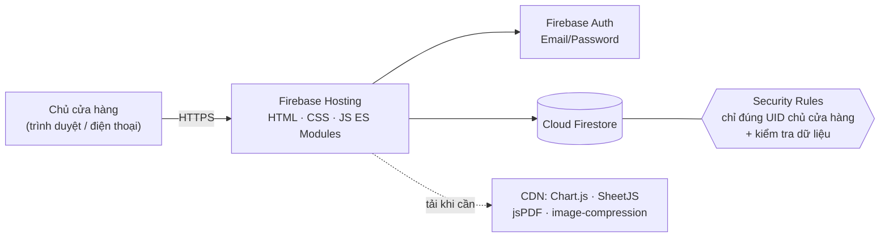
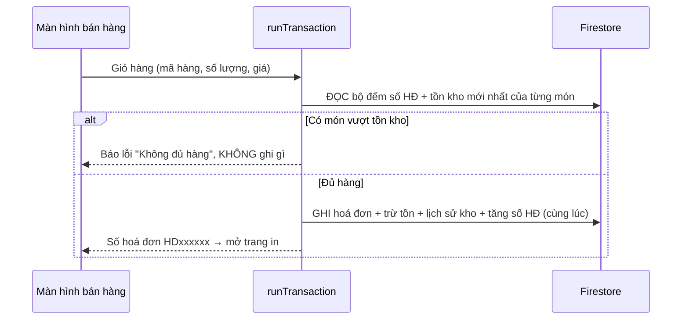

# 📦 Quản lý hàng hoá — Kho & Bán hàng trên Firebase

**Ứng dụng web quản lý kho và bán hàng cho cửa hàng nhỏ**, chạy hoàn toàn trên Firebase (không server riêng, không SQL). Chủ cửa hàng nhập hàng, bán hàng tại quầy, in hoá đơn, theo dõi tồn kho và xem báo cáo lãi lỗ — dữ liệu cập nhật realtime trên mọi thiết bị.

> *English summary:* A serverless inventory & point-of-sale web app for small shops, built with vanilla JavaScript (ES modules, no build step), Bootstrap 5 and Firebase (Auth, Cloud Firestore, Hosting). Stock changes run inside Firestore transactions so stock can never go negative; Security Rules lock all data to a single owner account and validate every write.


🔗 **Bản chạy thật:** https://quan-ly-hang-hoa-doh5v.web.app
*(Ứng dụng dành riêng cho chủ cửa hàng nên cần tài khoản để đăng nhập — mọi tài khoản khác bị Security Rules từ chối.)*

---

## ✨ Tính năng

| Nhóm | Chức năng |
|---|---|
| **Hàng hoá** | Thêm / sửa / xoá / xem chi tiết; tìm kiếm **không dấu** theo tên hoặc mã; lọc theo danh mục; sắp xếp; phân trang; tối đa 3 ảnh/sản phẩm (kéo-thả, xem trước, nén ảnh ngay trên trình duyệt) |
| **Danh mục** | Quản lý danh mục; đổi tên tự cập nhật lại tên hiển thị trên mọi sản phẩm |
| **Bán hàng (POS)** | Thêm hàng bằng ô tìm kiếm hoặc **máy quét mã vạch**; sửa giá, số lượng, giảm giá; tiền mặt (tự tính tiền thừa) / chuyển khoản / thẻ; phím tắt F2, F9; **không cho bán vượt tồn kho**; in hoá đơn khổ A5 hoặc máy in nhiệt K80 |
| **Nhập kho** | Phiếu nhập nhiều dòng hàng, tự cộng tồn kho, cập nhật **giá vốn bình quân gia quyền** |
| **Huỷ chứng từ** | Huỷ hoá đơn → cộng lại kho; huỷ phiếu nhập → trừ lại kho (bị chặn nếu hàng đã bán bớt) |
| **Cảnh báo** | Hàng sắp hết (tồn ≤ mức tối thiểu), cập nhật realtime, nút "Nhập thêm" mở sẵn phiếu nhập |
| **Báo cáo** | Lọc hôm nay / 7 ngày / tháng / năm / tuỳ chọn; doanh thu, chi phí nhập, lợi nhuận gộp, giá trị tồn kho; 4 biểu đồ; hàng bán chạy, tồn lâu, sắp hết, sản phẩm mới |
| **Xuất file** | **Excel** (9 sheet), **PDF** (nhúng font Roboto hiển thị đúng tiếng Việt, kèm biểu đồ và ảnh sản phẩm), **PNG** từng biểu đồ, nút In |
| **Tiền Việt** | Hiển thị `1.250.000 đ`; ô nhập tiền tự thêm dấu chấm hàng nghìn khi gõ |

---

## 🏗️ Kiến trúc



- **Không có backend riêng**: trình duyệt nói chuyện thẳng với Firestore; toàn bộ quyền truy cập và kiểm tra dữ liệu nằm ở [`firestore.rules`](firestore.rules).
- **Không có bước build**: mỗi trang là 1 file HTML nạp ES Module từ thư mục `js/`. Deploy chỉ cần `firebase deploy`.

### Luồng bán hàng (transaction)



---

## 🗄️ Thiết kế dữ liệu (Cloud Firestore)

| Collection | Nội dung chính | Ghi chú thiết kế |
|---|---|---|
| `categories` | tên, mô tả | |
| `products` | mã, tên, danh mục, đơn vị, giá nhập, giá bán, tồn, tồn tối thiểu, ảnh thu nhỏ | Lưu sẵn `categoryName`, `isLowStock`, `stockValue`, `searchKeywords` để truy vấn nhanh (giải thích bên dưới) |
| `product_images` | tối đa 3 ảnh (base64) của 1 sản phẩm | Tách riêng để danh sách sản phẩm không phải tải ảnh lớn |
| `imports` | số phiếu, ngày nhập, các dòng hàng, tổng tiền, trạng thái | Lưu sẵn tên + mã hàng trong từng dòng → xem/in không cần đọc thêm |
| `invoices` | số HĐ, ngày bán, các dòng hàng (kèm **giá vốn tại thời điểm bán**), giảm giá, tổng tiền, lợi nhuận, thanh toán | Lợi nhuận tính đúng kể cả khi giá vốn thay đổi về sau |
| `stock_logs` | mọi biến động kho: trước / sau / thay đổi / chứng từ | Chỉ được thêm, không sửa / xoá (lịch sử kiểm toán) |
| `counters` | bộ đếm số phiếu `PN000001`, `HD000001` | Tăng trong transaction → không trùng số |

**Vì sao lưu trùng (denormalize) một số field?** Firestore không có JOIN và không so sánh 2 field trong 1 truy vấn, nên:

- `isLowStock` (= `stock <= minStock`) → truy vấn "hàng sắp hết" bằng `where("isLowStock", "==", true)`. Security Rules bắt buộc cờ này luôn đúng.
- `stockValue` (= tồn × giá vốn) → báo cáo tính **giá trị tồn kho bằng 1 truy vấn `sum()`** thay vì tải cả kho.
- `searchKeywords` (tiền tố không dấu của tên và mã) → tìm kiếm bằng `array-contains`, gõ "ca phe" vẫn ra "Cà phê".

Index composite được khai báo trong [`firestore.indexes.json`](firestore.indexes.json) (kèm danh sách field **không** đánh index như mảng dòng hàng, ảnh base64 để ghi nhanh hơn).

---

## 🔍 Điểm kỹ thuật nổi bật

1. **Tồn kho không bao giờ âm** — mọi thay đổi kho (nhập, bán, huỷ) đi qua 1 module duy nhất [`js/stock.js`](js/stock.js) dùng `runTransaction`: đọc tồn mới nhất trên server, kiểm tra, rồi ghi chứng từ + tồn kho + lịch sử + số phiếu trong cùng 1 lần. Hai thiết bị bán cùng 1 món cùng lúc vẫn không bị sai. Security Rules chặn thêm lần nữa (`stock >= 0`).
2. **Security Rules vừa phân quyền vừa kiểm tra dữ liệu** — chỉ đúng 1 UID được đọc/ghi; kiểm tra field bắt buộc, kiểu dữ liệu, giá ≥ 0, không cho field lạ (`hasOnly`), thời gian phải là `serverTimestamp()`; hoá đơn/phiếu nhập không sửa được, chỉ được chuyển sang "đã huỷ".
3. **Phân trang bằng cursor** (`limit` + `startAfter`) kết hợp **realtime** (`onSnapshot`) — module dùng chung [`js/paginated-list.js`](js/paginated-list.js); không bao giờ tải cả collection.
4. **Báo cáo chỉ đọc dữ liệu cần thiết** — truy vấn theo khoảng ngày; tổng số / tổng tiền dùng aggregate query (`count()`, `sum()`).
5. **Tối ưu dung lượng & tốc độ**
   - Ảnh nén ngay trên trình duyệt: tối đa 1024px, **WebP** (tự chuyển JPEG nếu trình duyệt không hỗ trợ), ~150KB/ảnh; ảnh thu nhỏ ~10KB lưu cùng sản phẩm cho danh sách.
   - Thư viện nặng (SheetJS ~325KB, jsPDF ~110KB, nén ảnh) **chỉ tải khi bấm nút** ([`js/lazy-load.js`](js/lazy-load.js)).
   - Bật cache offline của Firestore (IndexedDB) → mở lại trang gần như tức thì.
6. **An toàn giao diện** — mọi dữ liệu người dùng được escape trước khi chèn HTML (chống XSS); lỗi Firebase được dịch sang thông báo tiếng Việt dễ hiểu; nút bấm khoá lại khi đang lưu để không ghi trùng.

---

## 📁 Cấu trúc thư mục

```
quan-ly-hang-hoa/
├── index.html              Đăng nhập
├── dashboard.html          Tổng quan (số liệu hôm nay, realtime)
├── products.html           Hàng hoá + upload ảnh
├── new-products.html       Sản phẩm mới (lưới card)
├── categories.html         Danh mục
├── sales.html              Bán hàng (POS) + danh sách hoá đơn
├── invoice-print.html      In hoá đơn A5 / K80
├── imports.html            Nhập kho + danh sách phiếu nhập
├── alerts.html             Cảnh báo hàng sắp hết
├── reports.html            Báo cáo, biểu đồ, xuất Excel / PDF / PNG
├── seed.html               Dữ liệu mẫu + công cụ tối ưu dữ liệu cũ
├── css/style.css
├── assets/fonts/           Roboto (nhúng vào PDF tiếng Việt)
├── js/
│   ├── firebase.js         Khởi tạo Firebase, re-export SDK (1 nơi duy nhất ghi phiên bản)
│   ├── config.js           Thông tin cửa hàng, cấu hình chung
│   ├── auth.js · layout.js Đăng nhập, route guard, sidebar
│   ├── stock.js            ★ Transaction nhập / bán / huỷ
│   ├── paginated-list.js   Phân trang cursor + realtime
│   ├── image-upload.js     Kiểm tra, nén, xem trước ảnh
│   ├── reports.js · export.js  Báo cáo, Excel, PDF, PNG
│   └── ...                 Mỗi trang 1 module tương ứng
├── firestore.rules         Security Rules
├── firestore.indexes.json  Composite index + field không đánh index
└── firebase.json           Cấu hình Hosting (cache header)
```

Khoảng **8.000 dòng** HTML / CSS / JavaScript, comment tiếng Việt ở các phần quan trọng.

---

## 🚀 Chạy thử trên máy của bạn

Yêu cầu: tài khoản Firebase (gói Spark miễn phí là đủ), Node.js (chỉ để chạy Firebase CLI).

1. Tạo project Firebase → bật **Authentication (Email/Password)** và **Cloud Firestore**.
2. Thêm 1 user ở *Authentication → Users*, copy **UID**.
3. Thay cấu hình của bạn vào:
   - `js/firebase.js` → `firebaseConfig` (thông tin công khai, bảo mật nằm ở Security Rules)
   - `js/config.js` → `OWNER_UID`, thông tin cửa hàng
   - `firestore.rules` → UID trong hàm `isOwner()`
   - `.firebaserc` → project ID
4. Deploy rules + index và web:
   ```bash
   npx firebase-tools login
   npx firebase-tools deploy
   ```
5. Đăng nhập → vào **Dữ liệu mẫu** → **Nạp dữ liệu mẫu** để có sẵn danh mục và hàng hoá.

Chạy cục bộ: mở bằng VS Code **Live Server** (không mở trực tiếp `file://` vì trình duyệt chặn ES Module).

---

## 📌 Giới hạn hiện tại & hướng phát triển

- Ảnh lưu dạng base64 trong Firestore để dùng được gói miễn phí; khi mở rộng nên chuyển sang **Firebase Storage** (đã tách riêng module ảnh nên chỉ cần thay 1 file).
- Báo cáo tính trên trình duyệt từ hoá đơn trong kỳ (giới hạn 5.000 chứng từ/kỳ); quy mô lớn hơn nên tổng hợp sẵn theo ngày bằng **Cloud Functions**.
- Hiện thiết kế cho **1 chủ cửa hàng**; nhiều nhân viên cần thêm phân quyền (custom claims) và rules theo vai trò.
- Chưa có kiểm thử tự động cho Security Rules (có thể thêm bằng Firebase Emulator + `@firebase/rules-unit-testing`).

---

*Font Roboto © Google, giấy phép Apache 2.0.*
